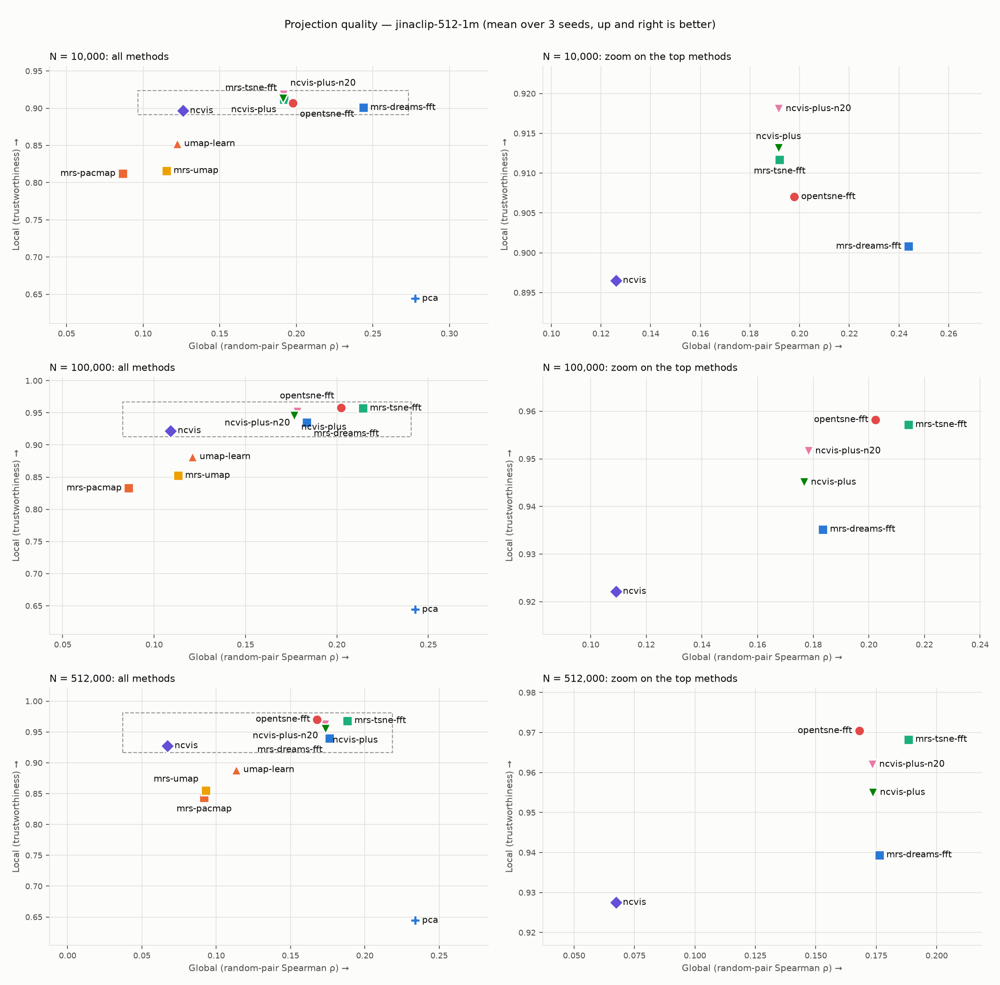

# drbench: dimensionality reduction benchmark

Which implementation gives the best 2D projection for the least compute?
Each algorithm runs end to end on raw vectors, with the same CPU budget for every run. Each run is scored on:

- **Local structure:** trustworthiness at k = 5, 15, 30. Continuity and kNN recall@15 are reported alongside.
- **Global structure:** Spearman ρ between original and 2D distances of 1M random point pairs. Triplet accuracy is reported alongside: the share of 1M random triplets (i, j, l) where "is j closer to i than l?" has the same answer in both spaces. Both use fixed samples whose sampling noise was measured (sd 0.001 and 0.0002–0.0005 on a fixed embedding), below the spread across seeds. k-means centroid scores were dropped because refitting k-means alone moved them by 0.01–0.08 ([#2](../../issues/2)).
- **Cost:** fit time and peak RSS.

## Quick start

```sh
uv sync                     # Python 3.12; builds the vendored ncvis (needs gcc + OpenMP)
uv run pytest
uv run drbench all          # prep → run → evaluate → report (full config: 100k × 8 algos × 3 seeds)
uv run drbench all --subsample 10000 --seeds 0 --results-dir results-smoke   # ~5 min smoke run
uv run drbench curves       # quality vs time: every algorithm over a grid of epoch budgets
uv run drbench scaling --datasets jinaclip-512-1m@10000,jinaclip-512-1m@100000 --algos ...  # SCALING.md
```

Results go to `results/`: `runs.jsonl`, `metrics.jsonl`, `summary.csv`, `REPORT.md` and `figures/`.
The steps resume where they left off: finished runs and evaluations are skipped. Pass `--retry-failed` to rerun failures and timeouts.

## Results: projection quality vs N

Ten methods, each with its best kNN setup (a shared [RINND](https://pypi.org/project/rinnd/)
graph, default parameters), on `jinaclip-512-1m` subsampled to N = 10k, 100k and 512k.
3 seeds, 36 threads (i9-7980XE). Tables per N: [`results/scaling/SCALING.md`](results/scaling/SCALING.md).



| method | combined 10k / 100k / 512k | local @512k | global @512k | fit time @512k | peak RAM @512k |
|---|---|---|---|---|---|
| mrs-tsne-fft | 0.76 / **0.91** / **0.86** | 0.968 | 0.188 | 73 s | 5.6 GB |
| [ncvis-plus](https://github.com/SeanPedersen/ncvis-plus)-n20 | 0.77 / 0.78 / 0.81 | 0.962 | 0.173 | 32 s | 1.8 GB |
| [ncvis-plus](https://github.com/SeanPedersen/ncvis-plus) | 0.77 / 0.77 / 0.80 | 0.955 | 0.174 | 20 s | 1.8 GB |
| opentsne-fft | 0.77 / 0.87 / 0.80 | **0.971** | 0.168 | 242 s | 4.2 GB |
| mrs-dreams-fft | **0.88** / 0.77 / 0.78 | 0.939 | 0.176 | 75 s | 5.4 GB |
| umap-learn | 0.47 / 0.49 / 0.51 | 0.889 | 0.114 | 43 s | 2.3 GB |
| pca | 0.50 / 0.50 / 0.50 | 0.644 | **0.234** | 1.4 s | 1.7 GB |
| ncvis | 0.56 / 0.52 / 0.43 | 0.928 | 0.067 | 23 s | 1.8 GB |
| mrs-umap | 0.39 / 0.42 / 0.40 | 0.855 | 0.093 | 18 s | 1.8 GB |
| mrs-pacmap | 0.31 / 0.30 / 0.38 | 0.844 | 0.092 | 120 s | 8.6 GB |

**local** = mean trustworthiness (k = 5, 15, 30); **global** = Spearman ρ of 1M random pairs.
**combined** = mean of local and global, each min-max scaled across these ten methods at that N
(1 = best on both). It is relative: it ranks methods within one N, not across N. Seed sd ≤ 0.004
local, ≤ 0.027 global.

- **t-SNE is the best at both local and global structure, at 100k and 512k.** manifolds-rs
  t-SNE matches openTSNE's local score, keeps more global structure, and is 3–15× faster.
- **NCVis+ comes closest to t-SNE at a fraction of the cost.** NCVis+ is NCVis with PCA init,
  retuned defaults and a faster kernel. At 512k it trails manifolds-rs t-SNE by 0.006–0.013
  local and 0.014 global, at 0.27–0.44× the time and a third of the memory. Stock NCVis falls
  below PCA in combined score at 512k (global ρ 0.067).
- **DREAMS (t-SNE pulled towards PCA) only pays off at 10k.** There it has the best combined
  score: global 0.244 against t-SNE's 0.192, for 0.011 less local. At 100k and 512k it is below
  plain t-SNE on both axes, with the same 750-iteration schedule.
- **The UMAPs and PaCMAP are worse than t-SNE on both axes** at every N. PCA is the other extreme:
  best global, far worst local.

Caveats:
- kNN graphs differ by method: k = 15 (UMAP, NCVis, NCVis+), 60 (PaCMAP), 90 (t-SNE, DREAMS). The
  graph's build time and memory are charged to every run that uses it.
- NCVis+ runs its own defaults (`min_dist` 0.001, 10 or 20 negatives per edge); the other methods
  use the shared min_dist 0.1.
- Trustworthiness depends on N, so compare methods within one N. At 512k it is estimated on 10k
  fixed anchor points (ranks exact over all N); at 10k and 100k every point is scored.
- `@100000` ⊂ `@512000`, but `@10000` is an independent draw.
- openTSNE's learning rate is N / exaggeration per phase, manifolds-rs uses max(N/12, 200); both run
  750 iterations.
- `jinaclip-512-1m` (999,500 × 512, L2-normalised) is a local file on the benchmark host, most likely
  jina-clip-v2 caption embeddings; its exact provenance is unconfirmed (`DRBENCH_JINACLIP_1M` sets the path).

### t-SNE repulsion: Barnes-Hut, qd, FFT

manifolds-rs t-SNE with three repulsion approximations: Barnes-Hut and FFT with their own IVF kNN,
all three with the shared RINND graph (k = 90). `dbpedia-512-100k`, 3 seeds, 36 threads, 750 iterations; fit time
includes the graph build. Full table: [`results/tsne-approx/REPORT.md`](results/tsne-approx/REPORT.md).

| method | local | global | fit time | peak RAM |
|---|---|---|---|---|
| mrs-tsne-bh | **0.9856** | 0.269 | 44 s | 1.1 GB |
| mrs-tsne-fft | 0.9851 | 0.271 | 24 s | 1.2 GB |
| mrs-tsne-bh-rinnd-default | 0.9826 | **0.291** | 33 s | 1.3 GB |
| mrs-tsne-fft-rinnd-default | 0.9823 | 0.284 | 21 s | 1.4 GB |
| mrs-tsne-qd-rinnd-default | 0.9786 | 0.286 | 17 s | 1.4 GB |

- **Barnes-Hut on the RINND graph keeps the most global structure** of these runs, with the same
  local score as FFT on that graph, at 1.5× FFT's time.
- **qd (qdtsne's depth-capped Barnes-Hut) is not worth it:** no faster than FFT on the same graph
  (13.4 vs 12.4 s with the fast graph), and 0.003–0.004 worse locally.
- With manifolds-rs's own kNN, local scores are higher and global lower than with the RINND graph.

Earlier results on `dbpedia-512-100k` (library defaults, epoch-budget curves, kNN backends):
[`results/REPORT.md`](results/REPORT.md), [`results/curves/CURVES.md`](results/curves/CURVES.md)
and [#1](../../issues/1).

## Datasets

- `jinaclip-512-1m`: see the caveats above.
- `dbpedia-512-100k`: 100k DBpedia entities embedded with OpenAI `text-embedding-3-small` (512-d),
  from [Qdrant on the HF Hub](https://huggingface.co/datasets/Qdrant/dbpedia-entities-openai3-text-embedding-3-small-512-100K), L2-normalised.

`name@N` selects a fixed random subsample.

## Algorithms

| name | library | language |
|---|---|---|
| `pca` | scikit-learn | Python |
| `opentsne-fft` | openTSNE | Python / C++ |
| `mrs-tsne-bh`, `mrs-tsne-fft`, `mrs-tsne-qd` (RINND variants only; qdtsne's depth-capped Barnes-Hut) | manifolds-rs | Rust (PyPI bindings) |
| `umap-learn` (0.6 pipeline), `umap-learn-legacy` (0.5 pipeline) | umap-learn | Python / numba |
| `mrs-umap` | manifolds-rs | Rust |
| `ncvis` | ncvis | C++ |
| `ncvis-ef64`: stock HNSW graph, query ef=64 (recall@15 ≈0.94 vs 0.85) | ncvis (patched) | C++ |
| `ncvis-hq`: HNSW M=16, efC=200, ef=64 (recall@15 ≈0.99) | ncvis (patched) | C++ |
| `mrs-pacmap` | manifolds-rs | Rust |
| `mrs-dreams-fft-rinnd-default`, `mrs-dreams-bh-rinnd-default`: DREAMS (t-SNE pulled towards the PCA layout) | manifolds-rs | Rust |
| `ncvis-plus` (own RINND graph), `ncvis-plus-rinnd-default`, `ncvis-plus-n20-rinnd-default` (20 negatives per edge): [NCVis+](https://github.com/SeanPedersen/ncvis-plus), NCVis with PCA init, retuned defaults (incl. `min_dist` 0.001) and a faster kernel | ncvis-plus | C++ |
| kNN-backend variants: `umap-learn-rinnd`, `opentsne-fft-nndescent`/`-exact`, `mrs-tsne-fft-nndescent`/`-hnsw` | as above | |
| `-rinnd-default` / `-rinnd-fast` variants of `opentsne-fft`, `mrs-tsne-fft`, `mrs-tsne-bh`, `mrs-tsne-qd`, `umap-learn`, `mrs-umap`, `mrs-pacmap`, `ncvis` (shared RINND graph, default or tuned-fast schedule; NCVis via a patch) | as above + RINND (Rust) | |

Shared hyperparameters are aligned across implementations: perplexity 30, n_neighbors 15 and min_dist 0.1. Everything else stays at library defaults.

## Two views

- **Defaults (`drbench all`).** Every library runs with its default settings, 3 seeds, scored exactly on all N. This answers "what do I get out of the box".
- **Curves (`drbench curves`).** Defaults ship very different training lengths: NCVis runs 50 epochs, UMAP 200–500, t-SNE 750–1000 iterations. So each tunable algorithm reruns with its default epochs scaled by ×⅛, ×¼, ×½, ×1 and ×2.
  - Early-exaggeration and init phases scale along with the main schedule.
  - An algorithm still improving between ×1 and ×2 gets one more run at ×4.
  - Curves are plotted against wall time and CPU time, never epochs, since epochs aren't comparable across algorithms.
  - Each point is a separate full run, so the kNN setup cost shows up as where each curve starts.
  - `CURVES.md` also lists the best local score each algorithm reaches within 5–300 s of wall time.
  - It uses 1 seed. Local scores are estimated on 10k fixed anchor points; their ranks are still exact over all N.

## Measurement protocol

- **Isolation:** every (dataset, algorithm, seed) runs in a fresh worker process. The worker gets the same thread count through `OMP/OPENBLAS/MKL/NUMBA/RAYON_NUM_THREADS` and the same CPU affinity.
- **Warm-up:** an untimed warm-up on 5,000 rows runs first, so numba JIT compilation is not measured. It must exceed 4,096 rows: below that umap-learn uses exact distances and never compiles its PyNNDescent path.
- **Time:** wall clock of `fit_transform` only. kNN search is included; data loading is not. CPU time (user + system over all threads) is recorded too, since libraries use the cores to different degrees.
- **Shared kNN graphs:** the `-rinnd-default` / `-rinnd-fast` variants build one RINND graph per (dataset, k) and reuse it across algorithms and seeds. A run that loads a stored graph is charged its build time (added to fit time, also recorded as `shared_knn_s`) and its extra peak memory, so it reports the same cost as building it. CPU time of the build is not charged.
- **Peak memory:** the kernel's VmHWM, reset after warm-up. The worker measures it, not wait4, because `ru_maxrss` inherits the parent's RSS across fork. Values include the interpreter, the data and loaded libraries; `delta_rss_mb` subtracts the pre-fit RSS.
- **Laptop throttling:** the run order is shuffled with a fixed seed, and `cooldown_s` adds a pause between runs. Time is the median over seeds.
- **Evaluation** runs as a separate step, using exact ranks (above 100k points: on 10k fixed anchor points): chunked BLAS distances plus a numba counting kernel, with no N×N matrix. Scores carry a metrics version; when a definition changes, `drbench evaluate` rescores the stored embeddings.

## TODO

- Datasets: FMNIST, image and audio embedding sets.
- Higher target dimensions (32, 128), scored by recall.
- Re-evaluate `results/` and `results/curves/` with the new global measures.
- Algorithms: umap-rs (a Rust CLI is needed, since it has no Python bindings), fast-umap (GPU), TriMap, VAE, SOM, (F)LAS, SAUCIE, SQuaD-MDS, IsoMap, DiRe-JAX.
