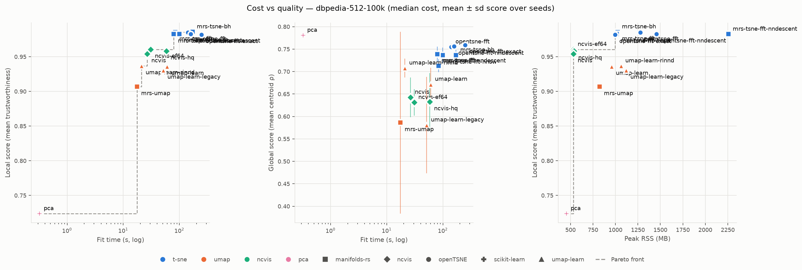
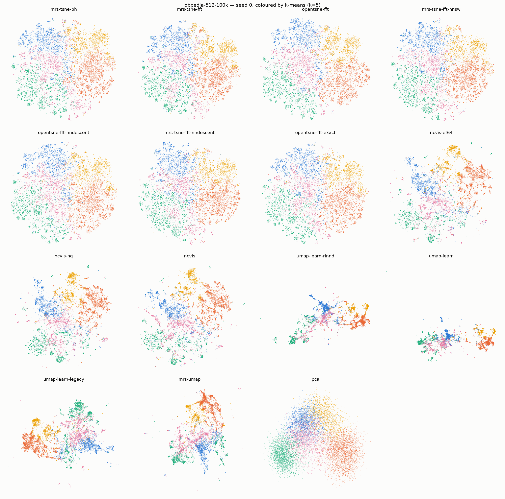

# Dimensionality reduction benchmark

Generated 2026-11-17 · 8 threads · seeds [0, 1, 2]

**local** = mean trustworthiness over k ∈ [5, 15, 30]; **global** = mean Spearman ρ of k-means centroid distances over k ∈ [5, 15, 30]. T = trustworthiness, C = continuity. Cost = median over seeds; scores = mean ± sd.

## dbpedia-512-100k

| algorithm | library | fit s | peak MB | local | global | T@5 | T@15 | T@30 | C@5 | C@15 | C@30 | recall | pair ρ | ok/failed |
| --- | --- | --- | --- | --- | --- | --- | --- | --- | --- | --- | --- | --- | --- | --- |
| mrs-tsne-bh | manifolds-rs | 171.8 | 1025 | 0.9859 ± 0.0001 | 0.7367 ± 0.0118 | 0.9921 | 0.9856 | 0.9799 | 0.9571 | 0.9448 | 0.9351 | 0.3114 | 0.2694 | 3/0 |
| mrs-tsne-fft | manifolds-rs | 84.0 | 1025 | 0.9856 ± 0.0002 | 0.7130 ± 0.0145 | 0.9910 | 0.9854 | 0.9803 | 0.9570 | 0.9447 | 0.9350 | 0.2989 | 0.2727 | 3/0 |
| opentsne-fft | openTSNE | 141.1 | 1276 | 0.9852 ± 0.0001 | 0.7549 ± 0.0079 | 0.9916 | 0.9849 | 0.9790 | 0.9566 | 0.9447 | 0.9352 | 0.3058 | 0.2909 | 3/0 |
| mrs-tsne-fft-hnsw | manifolds-rs | 99.3 | 1014 | 0.9829 ± 0.0001 | 0.7363 ± 0.0175 | 0.9898 | 0.9826 | 0.9763 | 0.9587 | 0.9447 | 0.9343 | 0.3022 | 0.2839 | 3/0 |
| opentsne-fft-nndescent | openTSNE | 158.6 | 1456 | 0.9826 ± 0.0001 | 0.7561 ± 0.0014 | 0.9906 | 0.9823 | 0.9750 | 0.9591 | 0.9449 | 0.9345 | 0.3107 | 0.2897 | 3/0 |
| mrs-tsne-fft-nndescent | manifolds-rs | 79.2 | 2259 | 0.9825 ± 0.0001 | 0.7391 ± 0.0162 | 0.9896 | 0.9822 | 0.9757 | 0.9586 | 0.9446 | 0.9342 | 0.3023 | 0.2861 | 3/0 |
| opentsne-fft-exact | openTSNE | 248.3 | 997 | 0.9819 ± 0.0002 | 0.7592 ± 0.0057 | 0.9904 | 0.9816 | 0.9739 | 0.9588 | 0.9443 | 0.9337 | 0.3113 | 0.2935 | 3/0 |
| ncvis-ef64 | ncvis | 30.7 | 533 | 0.9606 ± 0.0013 | 0.6312 ± 0.0295 | 0.9618 | 0.9608 | 0.9591 | 0.9503 | 0.9416 | 0.9296 | 0.1458 | 0.2091 | 3/0 |
| ncvis-hq | ncvis | 58.6 | 539 | 0.9582 ± 0.0005 | 0.6325 ± 0.0638 | 0.9594 | 0.9584 | 0.9567 | 0.9515 | 0.9430 | 0.9304 | 0.1459 | 0.2136 | 3/0 |
| ncvis | ncvis | 26.6 | 533 | 0.9541 ± 0.0008 | 0.6428 ± 0.0442 | 0.9551 | 0.9544 | 0.9528 | 0.9373 | 0.9284 | 0.9165 | 0.1420 | 0.2143 | 3/0 |
| umap-learn-rinnd | umap-learn | 21.1 | 1063 | 0.9368 ± 0.0009 | 0.7079 ± 0.0212 | 0.9385 | 0.9370 | 0.9350 | 0.9565 | 0.9417 | 0.9295 | 0.1126 | 0.2751 | 3/0 |
| umap-learn | umap-learn | 60.5 | 957 | 0.9360 ± 0.0019 | 0.6717 ± 0.0367 | 0.9375 | 0.9361 | 0.9342 | 0.9571 | 0.9422 | 0.9300 | 0.1123 | 0.2751 | 3/0 |
| umap-learn-legacy | umap-learn | 51.4 | 1119 | 0.9305 ± 0.0011 | 0.5810 ± 0.1073 | 0.9319 | 0.9307 | 0.9289 | 0.9596 | 0.9455 | 0.9330 | 0.1126 | 0.2354 | 3/0 |
| mrs-umap | manifolds-rs | 17.5 | 825 | 0.9068 ± 0.0018 | 0.5861 ± 0.2025 | 0.9087 | 0.9069 | 0.9048 | 0.9612 | 0.9451 | 0.9325 | 0.0974 | 0.2602 | 3/0 |
| pca | scikit-learn | 0.3 | 455 | 0.7238 ± 0.0000 | 0.7808 ± 0.0000 | 0.7237 | 0.7237 | 0.7240 | 0.9015 | 0.8911 | 0.8826 | 0.0021 | 0.3463 | 3/0 |

