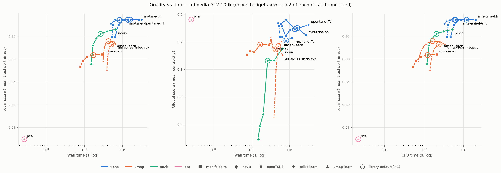

# Quality vs time (epoch-budget curves)

Each tunable algorithm reruns with its default epoch count scaled by ×0.125, ×0.25, ×0.5, ×1, ×2 (extended to ×4 if still improving by more than 0.002 local score). Seed 0, 8 threads. Every point is a separate full run (kNN included). Local scores are estimated on 10000 fixed anchor points, with exact ranks over all N. 'cores used' = CPU s / wall s.

## dbpedia-512-100k

### Best local score within a wall-time limit

| algorithm | ≤ 5 s | ≤ 15 s | ≤ 30 s | ≤ 60 s | ≤ 120 s | ≤ 300 s |
| --- | --- | --- | --- | --- | --- | --- |
| mrs-tsne-bh | – | – | – | – | 0.9855 (×0.5) | 0.9864 (×2) |
| mrs-tsne-fft | – | – | – | 0.9745 (×0.25) | 0.9862 (×2) | 0.9862 (×2) |
| mrs-umap | – | 0.9054 (×0.5) | 0.9101 (×2) | 0.9101 (×2) | 0.9101 (×2) | 0.9101 (×2) |
| ncvis | – | – | 0.9550 (×1) | 0.9608 (×2) | 0.9649 (×4) | 0.9649 (×4) |
| opentsne-fft | – | – | – | 0.9824 (×0.25) | 0.9851 (×0.5) | 0.9858 (×1) |
| pca | 0.7246 (×1) | 0.7246 (×1) | 0.7246 (×1) | 0.7246 (×1) | 0.7246 (×1) | 0.7246 (×1) |
| umap-learn | – | – | – | 0.9389 (×1) | 0.9389 (×1) | 0.9389 (×1) |
| umap-learn-legacy | – | – | – | 0.9317 (×1) | 0.9336 (×2) | 0.9336 (×2) |
| **best** | **pca** 0.7246 | **mrs-umap** 0.9054 | **ncvis** 0.9550 | **opentsne-fft** 0.9824 | **mrs-tsne-fft** 0.9862 | **mrs-tsne-bh** 0.9864 |

### All curve points

| algorithm | budget | epochs | wall s | CPU s | cores used | peak MB | local | global | T@15 | C@15 |
| --- | --- | --- | --- | --- | --- | --- | --- | --- | --- | --- |
| mrs-tsne-bh | ×0.125 | 125 | 62.7 | 465 | 7.4 | 1020 | 0.9475 | 0.7565 | 0.9475 | 0.9497 |
| mrs-tsne-bh | ×0.25 | 250 | 78.7 | 570 | 7.3 | 1032 | 0.9743 | 0.7208 | 0.9744 | 0.9470 |
| mrs-tsne-bh | ×0.5 | 500 | 104.2 | 776 | 7.4 | 1030 | 0.9855 | 0.7445 | 0.9855 | 0.9456 |
| mrs-tsne-bh | ×1 | 1000 | 158.5 | 1180 | 7.4 | 1022 | 0.9861 | 0.7502 | 0.9858 | 0.9456 |
| mrs-tsne-bh | ×2 | 2000 | 269.2 | 2010 | 7.5 | 1028 | 0.9864 | 0.7240 | 0.9862 | 0.9457 |
| mrs-tsne-fft | ×0.125 | 125 | 52.7 | 384 | 7.3 | 1024 | 0.9485 | 0.7569 | 0.9488 | 0.9496 |
| mrs-tsne-fft | ×0.25 | 250 | 55.8 | 408 | 7.3 | 1024 | 0.9745 | 0.7184 | 0.9745 | 0.9466 |
| mrs-tsne-fft | ×0.5 | 500 | 64.1 | 467 | 7.3 | 1026 | 0.9853 | 0.7179 | 0.9852 | 0.9454 |
| mrs-tsne-fft | ×1 | 1000 | 82.2 | 597 | 7.3 | 1031 | 0.9858 | 0.7049 | 0.9857 | 0.9455 |
| mrs-tsne-fft | ×2 | 2000 | 116.3 | 840 | 7.2 | 1023 | 0.9862 | 0.7145 | 0.9859 | 0.9456 |
| mrs-umap | ×0.125 | 62 | 7.8 | 52 | 6.7 | 820 | 0.8834 | 0.6541 | 0.8831 | 0.9459 |
| mrs-umap | ×0.25 | 125 | 9.2 | 62 | 6.8 | 790 | 0.8958 | 0.6663 | 0.8960 | 0.9462 |
| mrs-umap | ×0.5 | 250 | 11.8 | 83 | 7.0 | 827 | 0.9054 | 0.6619 | 0.9056 | 0.9457 |
| mrs-umap | ×1 | 500 | 17.1 | 124 | 7.2 | 860 | 0.9088 | 0.6903 | 0.9087 | 0.9460 |
| mrs-umap | ×2 | 1000 | 28.8 | 210 | 7.3 | 787 | 0.9101 | 0.6901 | 0.9098 | 0.9459 |
| ncvis | ×0.125 | 6 | 15.1 | 119 | 7.9 | 533 | 0.8891 | 0.3473 | 0.8893 | 0.9213 |
| ncvis | ×0.25 | 12 | 16.7 | 131 | 7.9 | 533 | 0.9296 | 0.3947 | 0.9299 | 0.9252 |
| ncvis | ×0.5 | 25 | 20.5 | 158 | 7.7 | 533 | 0.9452 | 0.4374 | 0.9457 | 0.9304 |
| ncvis | ×1 | 50 | 26.6 | 207 | 7.8 | 533 | 0.9550 | 0.6317 | 0.9550 | 0.9334 |
| ncvis | ×2 | 100 | 39.4 | 311 | 7.9 | 533 | 0.9608 | 0.6333 | 0.9611 | 0.9311 |
| ncvis | ×4 | 200 | 65.7 | 517 | 7.9 | 532 | 0.9649 | 0.6759 | 0.9652 | 0.9282 |
| opentsne-fft | ×0.125 | 94 | 49.8 | 328 | 6.6 | 1275 | 0.9773 | 0.7679 | 0.9771 | 0.9461 |
| opentsne-fft | ×0.25 | 188 | 58.9 | 370 | 6.3 | 1275 | 0.9824 | 0.7649 | 0.9824 | 0.9463 |
| opentsne-fft | ×0.5 | 375 | 81.0 | 450 | 5.6 | 1275 | 0.9851 | 0.7798 | 0.9850 | 0.9456 |
| opentsne-fft | ×1 | 750 | 138.1 | 628 | 4.5 | 1275 | 0.9858 | 0.7458 | 0.9855 | 0.9454 |
| opentsne-fft | ×2 | 1500 | 312.8 | 1035 | 3.3 | 1341 | 0.9864 | 0.7616 | 0.9860 | 0.9453 |
| pca | ×1 | – | 0.3 | 2 | 8.0 | 455 | 0.7246 | 0.7808 | 0.7249 | 0.8909 |
| umap-learn | ×0.125 | 25 | 30.6 | 71 | 2.3 | 958 | 0.8954 | 0.6968 | 0.8956 | 0.9425 |
| umap-learn | ×0.25 | 50 | 32.3 | 84 | 2.6 | 957 | 0.9195 | 0.7169 | 0.9195 | 0.9418 |
| umap-learn | ×0.5 | 100 | 35.9 | 111 | 3.1 | 957 | 0.9340 | 0.6834 | 0.9338 | 0.9398 |
| umap-learn | ×1 | 200 | 42.7 | 165 | 3.9 | 957 | 0.9389 | 0.6725 | 0.9389 | 0.9411 |
| umap-learn | ×2 | 400 | 61.2 | 276 | 4.5 | 952 | 0.9372 | 0.7023 | 0.9371 | 0.9424 |
| umap-learn-legacy | ×0.125 | 25 | 39.0 | 141 | 3.6 | 1104 | 0.8770 | 0.4276 | 0.8771 | 0.9433 |
| umap-learn-legacy | ×0.25 | 50 | 40.7 | 155 | 3.8 | 1104 | 0.9062 | 0.4631 | 0.9063 | 0.9451 |
| umap-learn-legacy | ×0.5 | 100 | 44.2 | 182 | 4.1 | 1121 | 0.9237 | 0.6031 | 0.9240 | 0.9472 |
| umap-learn-legacy | ×1 | 200 | 50.8 | 233 | 4.6 | 1119 | 0.9317 | 0.6841 | 0.9317 | 0.9483 |
| umap-learn-legacy | ×2 | 400 | 64.7 | 335 | 5.2 | 1119 | 0.9336 | 0.6536 | 0.9335 | 0.9477 |
