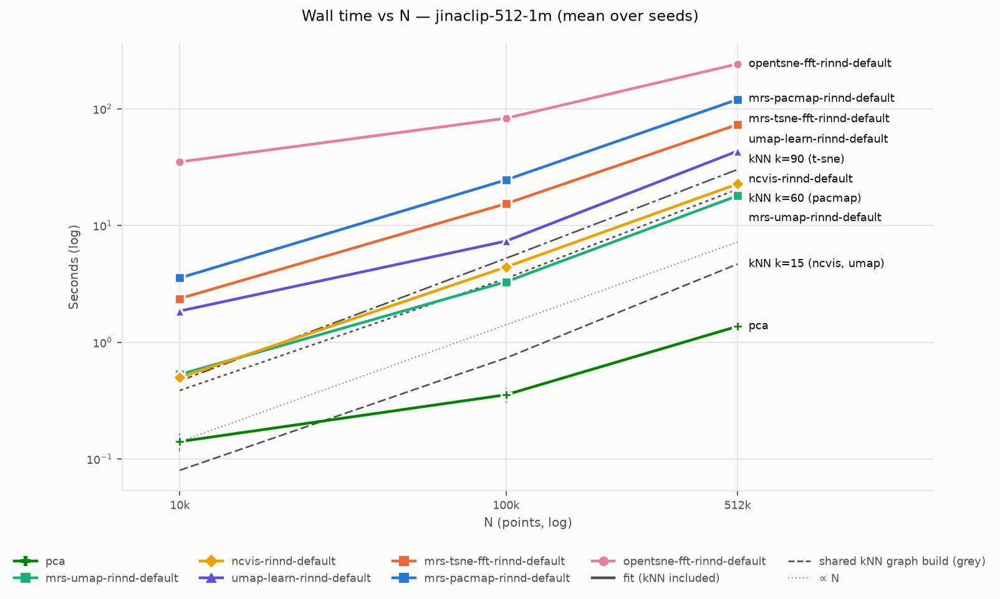
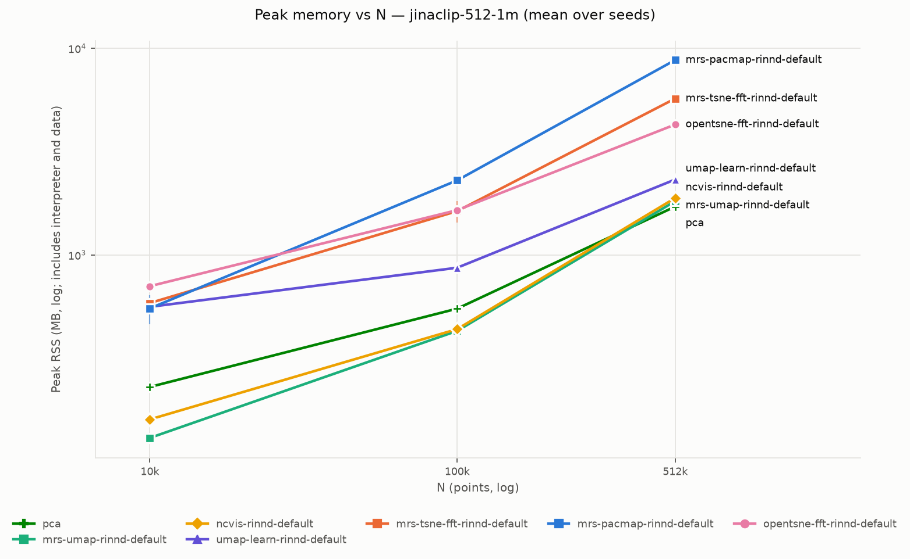
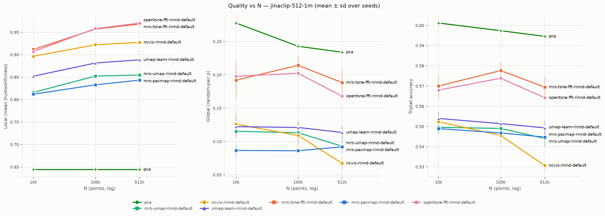

# Scaling with N — jinaclip-512-1m

36 threads · seeds [0, 1, 2] · mean ± sd over seeds. kNN s = build time of the shared RINND graph (charged to every run that uses it); layout s = fit s − kNN s. Local scores use 10,000 anchor points above N = 100,000, every point otherwise.

| algorithm | N | fit s | kNN s | layout s | peak MB | local | global | triplet | seeds |
| --- | --- | --- | --- | --- | --- | --- | --- | --- | --- |
| pca | 10,000 | 0.1 ± 0.0 | 0.0 ± 0.0 | 0.1 ± 0.0 | 230 ± 0 | 0.6443 ± 0.0000 | 0.278 ± 0.000 | 0.601 ± 0.000 | 3 |
| pca | 100,000 | 0.4 ± 0.1 | 0.0 ± 0.0 | 0.4 ± 0.1 | 549 ± 0 | 0.6442 ± 0.0000 | 0.243 ± 0.000 | 0.597 ± 0.000 | 3 |
| pca | 512,000 | 1.4 ± 0.1 | 0.0 ± 0.0 | 1.4 ± 0.1 | 1714 ± 0 | 0.6443 ± 0.0000 | 0.234 ± 0.000 | 0.595 ± 0.000 | 3 |
| mrs-umap-rinnd-default | 10,000 | 0.5 ± 0.0 | 0.1 ± 0.0 | 0.4 ± 0.0 | 130 ± 1 | 0.8160 ± 0.0041 | 0.115 ± 0.006 | 0.550 ± 0.003 | 3 |
| mrs-umap-rinnd-default | 100,000 | 3.3 ± 0.0 | 0.7 ± 0.0 | 2.6 ± 0.0 | 429 ± 1 | 0.8525 ± 0.0010 | 0.113 ± 0.015 | 0.549 ± 0.004 | 3 |
| mrs-umap-rinnd-default | 512,000 | 18.0 ± 0.0 | 4.7 ± 0.0 | 13.3 ± 0.0 | 1821 ± 2 | 0.8548 ± 0.0006 | 0.093 ± 0.011 | 0.544 ± 0.004 | 3 |
| ncvis-rinnd-default | 10,000 | 0.5 ± 0.1 | 0.1 ± 0.0 | 0.4 ± 0.1 | 160 ± 1 | 0.8965 ± 0.0018 | 0.126 ± 0.021 | 0.552 ± 0.005 | 3 |
| ncvis-rinnd-default | 100,000 | 4.4 ± 0.1 | 0.7 ± 0.0 | 3.7 ± 0.1 | 437 ± 0 | 0.9222 ± 0.0007 | 0.109 ± 0.022 | 0.546 ± 0.005 | 3 |
| ncvis-rinnd-default | 512,000 | 22.7 ± 0.2 | 4.7 ± 0.0 | 18.0 ± 0.2 | 1885 ± 0 | 0.9275 ± 0.0010 | 0.067 ± 0.009 | 0.531 ± 0.002 | 3 |
| umap-learn-rinnd-default | 10,000 | 1.8 ± 0.0 | 0.1 ± 0.0 | 1.8 ± 0.0 | 561 ± 1 | 0.8522 ± 0.0031 | 0.122 ± 0.014 | 0.554 ± 0.003 | 3 |
| umap-learn-rinnd-default | 100,000 | 7.3 ± 0.0 | 0.7 ± 0.0 | 6.6 ± 0.0 | 867 ± 1 | 0.8816 ± 0.0003 | 0.121 ± 0.009 | 0.551 ± 0.001 | 3 |
| umap-learn-rinnd-default | 512,000 | 43.3 ± 0.1 | 4.7 ± 0.0 | 38.7 ± 0.1 | 2318 ± 2 | 0.8887 ± 0.0021 | 0.114 ± 0.010 | 0.549 ± 0.003 | 3 |
| mrs-tsne-fft-rinnd-default | 10,000 | 2.4 ± 0.0 | 0.5 ± 0.0 | 1.9 ± 0.0 | 585 ± 24 | 0.9117 ± 0.0011 | 0.192 ± 0.027 | 0.570 ± 0.005 | 3 |
| mrs-tsne-fft-rinnd-default | 100,000 | 15.4 ± 0.1 | 5.2 ± 0.0 | 10.1 ± 0.1 | 1629 ± 198 | 0.9572 ± 0.0006 | 0.214 ± 0.014 | 0.578 ± 0.004 | 3 |
| mrs-tsne-fft-rinnd-default | 512,000 | 73.2 ± 0.2 | 30.2 ± 0.0 | 43.0 ± 0.2 | 5714 ± 325 | 0.9683 ± 0.0006 | 0.188 ± 0.018 | 0.569 ± 0.005 | 3 |
| mrs-pacmap-rinnd-default | 10,000 | 3.5 ± 0.1 | 0.4 ± 0.0 | 3.2 ± 0.1 | 551 ± 89 | 0.8122 ± 0.0023 | 0.087 ± 0.009 | 0.549 ± 0.002 | 3 |
| mrs-pacmap-rinnd-default | 100,000 | 24.6 ± 0.3 | 3.5 ± 0.0 | 21.0 ± 0.3 | 2296 ± 100 | 0.8330 ± 0.0002 | 0.086 ± 0.003 | 0.547 ± 0.001 | 3 |
| mrs-pacmap-rinnd-default | 512,000 | 120.0 ± 0.6 | 20.4 ± 0.0 | 99.5 ± 0.6 | 8779 ± 43 | 0.8435 ± 0.0007 | 0.092 ± 0.001 | 0.545 ± 0.000 | 3 |
| opentsne-fft-rinnd-default | 10,000 | 35.0 ± 1.2 | 0.5 ± 0.0 | 34.6 ± 1.2 | 706 ± 11 | 0.9070 ± 0.0020 | 0.198 ± 0.021 | 0.568 ± 0.004 | 3 |
| opentsne-fft-rinnd-default | 100,000 | 82.9 ± 0.5 | 5.2 ± 0.0 | 77.6 ± 0.5 | 1647 ± 2 | 0.9582 ± 0.0002 | 0.202 ± 0.005 | 0.574 ± 0.002 | 3 |
| opentsne-fft-rinnd-default | 512,000 | 241.8 ± 0.6 | 30.2 ± 0.0 | 211.7 ± 0.6 | 4278 ± 48 | 0.9705 ± 0.0002 | 0.168 ± 0.003 | 0.564 ± 0.001 | 3 |

