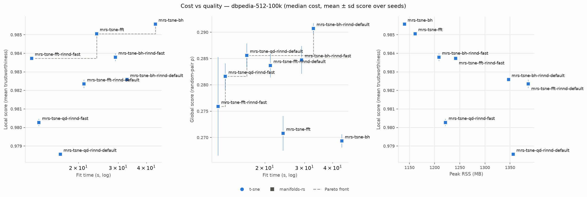
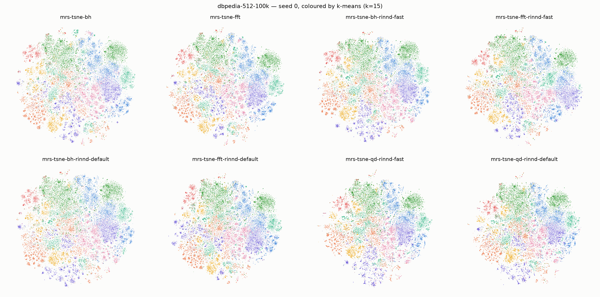

# Dimensionality reduction benchmark

Generated 2026-11-17 · 36 threads · seeds [0, 1, 2]

**local** = mean trustworthiness over k ∈ [5, 15, 30]; **global** = Spearman ρ of original vs 2D distances over 1,000,000 random pairs. **triplet** = share of 1,000,000 random triplets whose closer pair is the same in both spaces. T = trustworthiness, C = continuity. Cost = median over seeds; scores = mean ± sd.

## dbpedia-512-100k

| algorithm | library | fit s | peak MB | local | global | T@5 | T@15 | T@30 | C@5 | C@15 | C@30 | recall | triplet | ok/failed |
| --- | --- | --- | --- | --- | --- | --- | --- | --- | --- | --- | --- | --- | --- | --- |
| mrs-tsne-bh | manifolds-rs | 43.9 | 1140 | 0.9856 ± 0.0001 | 0.2693 ± 0.0013 | 0.9911 | 0.9855 | 0.9802 | 0.9571 | 0.9447 | 0.9351 | 0.2993 | 0.5960 ± 0.0004 | 3/0 |
| mrs-tsne-fft | manifolds-rs | 24.1 | 1161 | 0.9851 ± 0.0001 | 0.2708 ± 0.0033 | 0.9902 | 0.9850 | 0.9800 | 0.9570 | 0.9447 | 0.9350 | 0.2907 | 0.5967 ± 0.0009 | 3/0 |
| mrs-tsne-bh-rinnd-fast | manifolds-rs | 29.2 | 1208 | 0.9838 ± 0.0002 | 0.2847 ± 0.0026 | 0.9902 | 0.9835 | 0.9776 | 0.9587 | 0.9456 | 0.9356 | 0.3011 | 0.6002 ± 0.0008 | 3/0 |
| mrs-tsne-fft-rinnd-fast | manifolds-rs | 12.4 | 1242 | 0.9837 ± 0.0001 | 0.2759 ± 0.0094 | 0.9897 | 0.9836 | 0.9779 | 0.9583 | 0.9452 | 0.9352 | 0.2932 | 0.5979 ± 0.0027 | 3/0 |
| mrs-tsne-bh-rinnd-default | manifolds-rs | 32.9 | 1347 | 0.9826 ± 0.0001 | 0.2907 ± 0.0010 | 0.9897 | 0.9822 | 0.9759 | 0.9591 | 0.9452 | 0.9350 | 0.3029 | 0.6016 ± 0.0004 | 3/0 |
| mrs-tsne-fft-rinnd-default | manifolds-rs | 21.2 | 1386 | 0.9823 ± 0.0002 | 0.2837 ± 0.0023 | 0.9890 | 0.9820 | 0.9760 | 0.9588 | 0.9448 | 0.9344 | 0.2948 | 0.6001 ± 0.0004 | 3/0 |
| mrs-tsne-qd-rinnd-fast | manifolds-rs | 13.4 | 1222 | 0.9803 ± 0.0002 | 0.2816 ± 0.0025 | 0.9849 | 0.9802 | 0.9756 | 0.9583 | 0.9450 | 0.9349 | 0.2581 | 0.5993 ± 0.0008 | 3/0 |
| mrs-tsne-qd-rinnd-default | manifolds-rs | 16.7 | 1357 | 0.9786 ± 0.0001 | 0.2856 ± 0.0023 | 0.9837 | 0.9784 | 0.9736 | 0.9586 | 0.9444 | 0.9340 | 0.2598 | 0.6000 ± 0.0006 | 3/0 |

